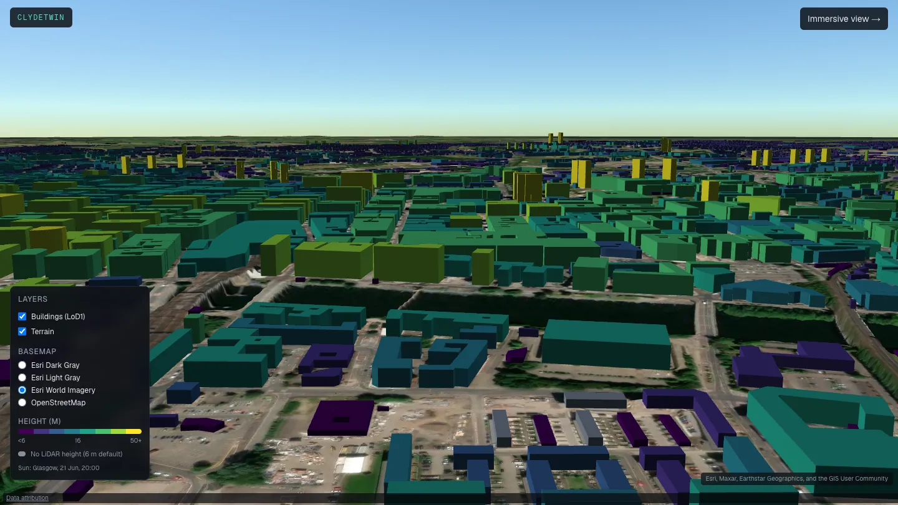
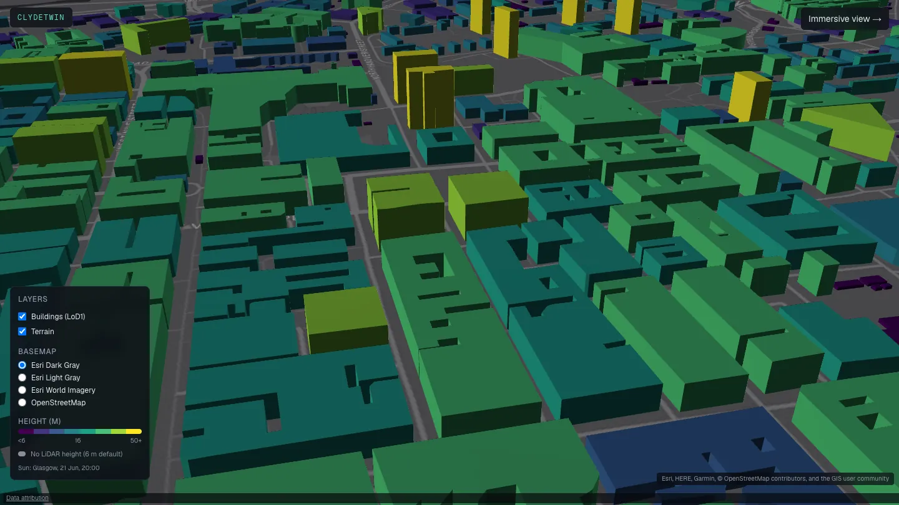
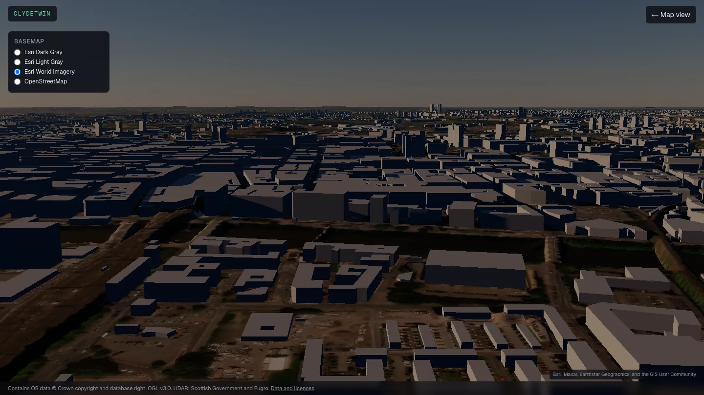
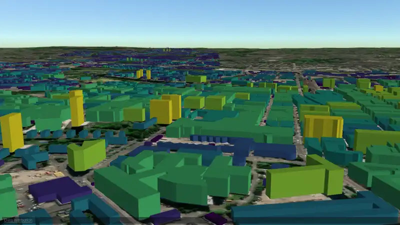
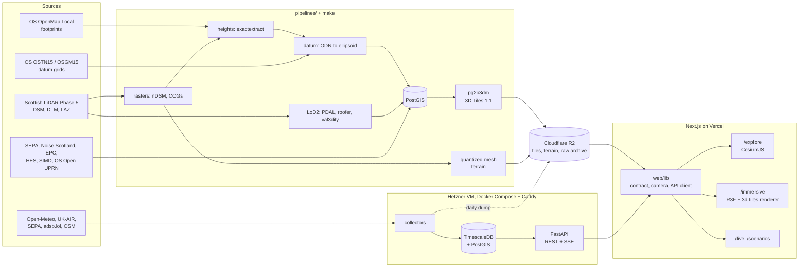

# ClydeTwin

**An open-data 3D digital twin of Glasgow: every building extruded from public LiDAR, in the browser.**

[](LICENSE)
[](https://github.com/fakmalpradana/clydetwin/actions/workflows/ci.yml)
[](CHANGELOG.md)
[](https://clydetwin.vercel.app)
[](DATA_LICENSES.md)

[](https://clydetwin.vercel.app/explore)

| `/explore` (CesiumJS) | `/immersive` (three.js) |
|---|---|
|  |  |

Orbit around the city centre:



**Live demo: <https://clydetwin.vercel.app>**. Screenshots use an evening sun (`t=2026-06-21T19:00:00Z`) for illustration.

## Live demo

| What | Where |
|---|---|
| Web app (Vercel) | <https://clydetwin.vercel.app> |
| 3D explorer | [`/explore`](https://clydetwin.vercel.app/explore) |
| Cinematic view | [`/immersive`](https://clydetwin.vercel.app/immersive) (`?q=low\|medium\|high`, `?hud=1` for fps) |
| Live conditions | [`/live`](https://clydetwin.vercel.app/live) |
| Flood exposure scenario | [`/scenarios/flood`](https://clydetwin.vercel.app/scenarios/flood) (not a forecast) |
| API (Hetzner VM) | <https://clydetwin.178-105-182-162.sslip.io> (`/api/v1/health`) |

The API runs on one small VM, so it can be slow or briefly down; the web app then falls back to sample data and says so.
Aircraft are live (adsb.lol), the Subway is a timetable simulation, and river data is unavailable until SEPA grants access.

## What is ClydeTwin

ClydeTwin turns public data into a living 3D model of Glasgow. Footprints come from OS OpenMap Local, heights from the
Scottish LiDAR programme (Phase 5, 50 cm), ground from our own terrain built from the same LiDAR, and everything is
published under open licences. Click any building to see its height, where that number comes from and how reliable it
is (a 6 m placeholder is drawn grey, never hidden). The method, the QA numbers and the mistakes found along the way
are written down in [`docs/methods/`](docs/methods/lod1.md) and [`docs/decisions/`](docs/decisions/).

100% open data: no proprietary building or height product feeds anything that is published
(see [`DATA_LICENSES.md`](DATA_LICENSES.md)).

## Features and status

| Phase | Scope | Status |
|---|---|---|
| 1 | LoD1 buildings for all of Glasgow City, own LiDAR terrain, `/explore`, `/immersive` v0.1 | ✅ released as `v0.1.0` / `v0.1.1` |
| 2 | Live environment (weather, rivers, rainfall, air quality), flood zones, API | ✅ gate passed; the 72 h ingest soak is still running on the VM (since 2026-10-15), result pending |
| 3 | Moving city: live aircraft, simulated Subway, 24 h time slider | ✅ built and checked against the live API; buses, trains and traffic wait for accounts |
| 4 | LoD2 pilot, per-building analytics, thematic styling, flood scenario | ✅ val3dity gate met; roof RMSE target redefined (per-building median 1.45 m), NGD validation pending |
| 5 | `/immersive` v1: data-driven cinematic "Glasgow Now" | ✅ built; the Medium >= 50 fps gate on a MacBook is not measured yet |
| 6 to 7 | Full-city LoD2, research analytics, v1.0 | ⏳ |

Release tags `v0.2.0` to `v0.5.0` are prepared in [`CHANGELOG.md`](CHANGELOG.md) but not cut yet. Per-phase gate
results are in [`docs/release/`](docs/release/).

What works today:

- `/explore`: all buildings coloured by height (viridis), click for the attribute panel, layer toggles, camera in the URL
  (`lon, lat, h, hd, p`), real-sun lighting for Glasgow, six switchable basemaps (Esri dark/light gray, Esri imagery,
  OSM, optional Google via the official Map Tiles API).
- `/immersive`: React Three Fiber, same tileset and terrain, physical sky and sun shadows, imagery draped on terrain,
  weak-GPU fallback to `/explore`, two-way switch that keeps the camera. Phase 5 adds data-driven effects: volumetric
  clouds from `/now` cloud cover, rain and a wet look from precipitation, a Clyde water surface that follows the nearest
  gauge, procedural sandstone façades with lit windows at night, quality presets (`?q=low|medium|high`, `?hud=1` for the
  fps), and camera modes (orbit, drone tour, follow a vehicle, ±12 h time-lapse). Demo clip: see "Demo clip" below. Debug: `?wx=low,mid,high,precip` forces weather.
- `/live`, the `/explore` ticker and river gauges: weather, air quality, rainfall, flood zones (Phase 2). River gauges show
  "unavailable" until SEPA access is granted.
- Mobility (Phase 3): live aircraft around Glasgow Airport, a simulated Subway, click to follow, 24 h replay slider.
  Every vehicle is badged live, scheduled or simulated.
- Analytics (Phase 4): themes for EPC rating, flood, noise and heritage, Data Zone choropleth (SIMD, density), `/scenarios/flood`,
  a LoD2 pilot of 661 buildings in the city centre, and `/about/methods`.
- `/about/data`: every attribution, licence and the non-operational disclaimer.

### Demo clip

Record on a real GPU (headless WebGL is too slow and can leave tiles unloaded):
open `/immersive?q=high&mode=tour&tourspeed=1&t=2026-06-15T17:30:00Z&wx=45,30,40,0`, wait for the tiles, record with macOS
Screenshot (Cmd+Shift+5) or OBS, then shrink to at most 8 MB:

```
ffmpeg -i in.mov -vf scale=1280:-2 -c:v libvpx-vp9 -crf 34 -b:v 0 -an docs/media/p5/drone-tour.webm
```

`web/scripts/capture-tour.py` renders the same tour headlessly frame by frame, but check its frames (see its header).

## Architecture



The web app stays usable without the API (fixture mode with labelled sample data). Two renderers over one shared contract: [ADR-004](docs/decisions/ADR-004-two-renderers.md). Own terrain instead of ion
World Terrain (which is about 14 m too high here): [ADR-002](docs/decisions/ADR-002-terrain.md).

## Data sources

| Dataset | Publisher | Licence | Update | Used for |
|---|---|---|---|---|
| OS OpenMap Local (`Building`) | Ordnance Survey | OGL v3.0 | OS release cycle | footprints |
| Scottish LiDAR Phase 5 (DSM, DTM) | Scottish Government and Fugro | OGL v3.0 | static (flown 2020-21) | heights, ground, terrain |
| OS Boundary-Line | Ordnance Survey | OGL v3.0 | OS release cycle | city boundary (AOI) |
| OSTN15 / OSGM15 grids | Ordnance Survey (via PROJ) | OS OpenData terms | static | ODN to ellipsoidal heights |
| UK-AIR (Defra) SOS API | Defra | OGL v3.0 (wording to be confirmed, ADR-007) | hourly | `/live` air quality (PM2.5, NO2) |
| Open-Meteo (UK Met Office model) | Open-Meteo | CC BY 4.0 | hourly | weather, cloud cover, rain |
| SEPA KiWIS river level and rainfall | SEPA | OGL v3.0 | 15 min | river gauges (access pending) |
| SEPA flood maps (river, coastal, surface water) | SEPA | OGL v3.0 | per release | flood zones, building flood likelihood |
| adsb.lol | adsb.lol | ODbL 1.0 (kept separate) | 60 s | live aircraft |
| OSM `railway=subway`, NaPTAN | OSM contributors, DfT | ODbL 1.0, OGL v3.0 | static | simulated Subway |
| Scottish LiDAR Phase 5 (LAZ) | Scottish Government and Fugro | OGL v3.0 | static | LoD2 pilot |
| OS Open UPRN, OS Open Linked Identifiers | Ordnance Survey | OGL v3.0 | OS release cycle | `building_id` to UPRN to TOID crosswalk |
| Noise Mapping Scotland, Round 4 | Scottish Government | OGL v3.0 | static (2021) | noise exposure |
| Scottish EPC register (domestic) | Scottish Government | OGL v3.0 | quarterly | EPC aggregate, no addresses |
| HES listed buildings and conservation areas | Historic Environment Scotland | OGL v3.0 | per release | heritage flags |
| Data Zones 2022, SIMD 2020v2, NRS population | Scottish Government, NRS | OGL v3.0 | static | choropleth |
| Esri gray canvases and World Imagery | Esri and partners | Esri terms, attribution shown | continuous | basemaps |
| OpenStreetMap tiles | OpenStreetMap contributors | ODbL 1.0 (kept separate from OGL layers) | continuous | basemap |
| Google Map Tiles (optional) | Google | Google Map Tiles API terms | continuous | basemap, only with a key |

Required attributions and the licensing rules for public tiles are in [`DATA_LICENSES.md`](DATA_LICENSES.md); the
verification of each source is in [`docs/data-verification.md`](docs/data-verification.md).

## Quickstart

Prerequisites: [Docker](https://docs.docker.com/get-docker/) (running), [uv](https://docs.astral.sh/uv/),
Node 22, and the GDAL command line tools (`brew install gdal` or `apt install gdal-bin`).

```sh
cp .env.example .env
make setup                 # uv sync + pre-commit hooks
make lod1                  # MODE=sample: one 1 km tile at George Square, a few minutes, ~100 MB of downloads
make serve-tiles           # tiles at http://localhost:8081/lod1/tileset.json

cd web
echo "NEXT_PUBLIC_TILESET_URL=http://localhost:8081/lod1/tileset.json" > .env.local
npm ci && npm run dev      # http://localhost:3000
```

All of Glasgow City: `make lod1 MODE=aoi` (13.4 GB LiDAR download; afterwards about 8 min for rasters, 70 s for
heights, 3 min for tiles, 90 MB of tiles) and `make terrain MODE=aoi` (own quantized-mesh terrain, about 350 MB), then
`make serve-tiles MODE=aoi PORT=8082` and `make serve-terrain MODE=aoi`, and point `NEXT_PUBLIC_TILESET_URL` /
`NEXT_PUBLIC_TERRAIN_URL` at them. There is no `make dev`: the web app is a plain Next.js project in `web/`.
Optional keys (`NEXT_PUBLIC_CESIUM_ION_TOKEN`, `NEXT_PUBLIC_GOOGLE_MAPS_KEY`) are described in `.env.example`; without
them the app uses flat/own terrain and the free basemaps.

## Repository layout and `make` targets

```
pipelines/   Python data pipeline (aoi, lidar, rasters, footprints, heights, datum, tiles, terrain, publish)
web/         Next.js app: /, /explore, /immersive, /about/data; web/lib is the shared contract
db/          SQL for the build-time PostGIS (extrusion)
docs/        ROADMAP, PROGRESS, phase briefs, methods, ADRs, media
tests/       pytest (datum test vectors, footprints, heights)
api/          FastAPI service (REST + SSE)
collectors/  weather, air quality, SEPA, aircraft, Subway loader, R2 archive and backfill
deploy/      VM deploy kit (Caddy, compose, README)
```

| Target | What it does |
|---|---|
| `make setup` | `uv sync` and install pre-commit hooks |
| `make lint` / `make test` | ruff / pytest |
| `make db-up` / `make db-down` | local PostGIS (Docker) used to build tiles |
| `make lod1 [MODE=sample\|aoi]` | footprints + LiDAR heights to validated 3D Tiles in `build/$(MODE)/tiles` |
| `make terrain [MODE=...]` | own quantized-mesh terrain from the DTM, with a check |
| `make serve-tiles [MODE=... PORT=...]` | serve tiles over HTTP with CORS |
| `make serve-terrain [MODE=...]` | serve terrain with the gzip header it needs |
| `make publish [MODE=...]` | upload tiles and terrain to Cloudflare R2 under `lod1/v1/` and `terrain/v1/` (`TILE_VERSION`; needs `R2_*` in `.env`) |

Live stack: `make live-up` (TimescaleDB + API + collectors), `make migrate`, `make backfill`, `make soak-report`, `make analytics`, `make tiles-attrs`; see [`deploy/README.md`](deploy/README.md).

Web: `cd web && npm run dev | build | lint | test`.

## Method and validation

Full city LoD1 v1 (81,131 buildings; the airport extension in `lod1/v2` brings it to 86,286), 2026-10-01 ([`docs/methods/lod1.md`](docs/methods/lod1.md)):

- 81,131 footprints selected, 81,131 in the tileset (100%); 0 dropped for missing ground.
- 2.99% of buildings have no usable LiDAR height and get a 6 m default (flagged `height_source = default`).
- LoD1 height is the 70th percentile of the normalised surface model per footprint; median 7.2 m, max 70.1 m.
- Datum conversion (ODN to ellipsoid with OSGM15) matches the 29 official OS test vectors to 2 mm.
- `3d-tiles-validator`: 0 errors, 0 warnings. 389 tiles, 90 MB.
- Own terrain agrees with building ground heights within 0.4 m at five checked buildings; in the viewer, 94% of 186
  buildings spread across the city sit within 2 m of terrain (median 0.3 m).
- Landmarks: four of five tall buildings agree with published heights within 2.3 m (`h_max`).

Known limitation: towers on podiums are drawn at the main-body height until LoD2 (Phase 4).

## Roadmap and changelog

Plan and phase gates: [`docs/ROADMAP.md`](docs/ROADMAP.md) (Indonesian), live status in
[`docs/PROGRESS.md`](docs/PROGRESS.md), release notes in [`CHANGELOG.md`](CHANGELOG.md).

## Contributing

[`CONTRIBUTING.md`](CONTRIBUTING.md): Conventional Commits with a scope, one atomic commit per change, pre-commit
(ruff, gitleaks, 1 MB file limit), tests with `uv run pytest` and `cd web && npm test`. Data, tiles and `.env` never
go into git.

## Citation, licences and attribution

Cite with [`CITATION.cff`](CITATION.cff) (GitHub's "Cite this repository"). Code: AGPL-3.0-or-later. Derived data
(tiles, heights): CC BY-SA 4.0. Documentation: CC BY 4.0. Layers derived from OpenStreetMap are ODbL and kept
separate. Required attributions:

```
Contains OS data © Crown copyright and database right.
Contains public sector information licensed under the Open Government Licence v3.0.
LiDAR: Crown copyright Scottish Government and Fugro (2020).
```

Basemap credits are shown on the map and listed in [`DATA_LICENSES.md`](DATA_LICENSES.md) and `/about/data`.

## Disclaimer and author

ClydeTwin is a research and portfolio project and is **not operational**: heights are estimated from public LiDAR,
not survey grade. Do not use it for navigation, safety, engineering or planning decisions.

Built by **Fairuz Akmal Pradana**, geospatial engineer, MSc Computational Geoscience (University of Glasgow, from
September 2026). [LinkedIn](https://www.linkedin.com/in/fairuz-akmal-pradana-52688b202/) ·
[GitHub](https://github.com/fakmalpradana) · fakmalpradana@gmail.com
